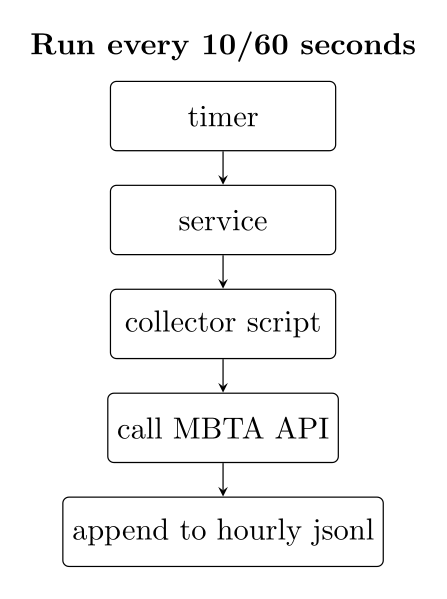
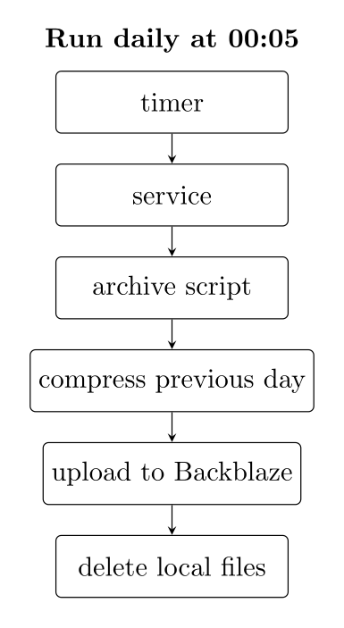

# MBTA Data Collector

I originally wanted to make a visualization of MBTA vehicles moving around Boston using _actual_ location data. Not a simulation, but something where I could pick a date and time and see where the trains and buses were.

The problem? The [MBTA API](https://api-v3.mbta.com/) gives you current vehicle positions, but not the historical snapshots I needed. If I wanted to replay a random Tuesday morning, I'd have to collect the data that Tuesday morning.

So I wrote a couple of Python scripts to save it. Then I needed them to run every few seconds without me babysitting them. And then I had to figure out what to do with all the files.

I've played around with a few visualizations for fun, like [this one](https://www.youtube.com/watch?v=QNU9GKpEVsM), but I still haven't built the historical replay I originally wanted. For now, I've got a collector running on a Linux server and a bunch of historical MBTA data to experiment with.

## What it does

- **Every 10 seconds:** requests the current vehicle positions from the MBTA API.
- **Every minute:** requests service alerts.
- **After each request:** saves the data (or an error record) to a JSONL file and writes a log entry.
- **Once a day:** compresses the previous day's files, uploads them to Backblaze B2, and deletes the local copies if the upload succeeds.

It's written in Python and runs on a DigitalOcean droplet using `systemd` services and timers. I went with JSONL instead of a database because I mainly needed to collect the data for now, not query it in real time.

**Want the graphs?** I went through a full month of collection results in the [January 2026 report](docs/january-2026-report.md), including missed runs, API response times, storage, and some transit patterns.

## Why every ten seconds?

At first, I considered collecting vehicle positions **every second**. But that would've meant ten times as many requests and snapshots as a ten-second schedule, which is a lot of extra data to store.

Plus, polling the API every second doesn't mean a vehicle's reported position actually changes every second. It depends on when the underlying vehicle information gets updated. So even if I collected more frequently, I wouldn't necessarily get ten times as much _new_ information.

I settled on ten seconds as a compromise. It should give me enough positions to interpolate between snapshots when I eventually try making the visualization, without saving quite so much duplicate data. Alerts seemed fine at once a minute.

## How it works

### Collecting the data

I use two scripts:

- [`collectors/vehicles-collector.py`](collectors/vehicles-collector.py) — calls `GET https://api-v3.mbta.com/vehicles`.
- [`collectors/alerts-collector.py`](collectors/alerts-collector.py) — calls `GET https://api-v3.mbta.com/alerts`.

I got an MBTA API key rather than relying on anonymous requests. The API supports both, but a key gives me a less restrictive request limit, which seemed like a better idea for something running all day. The scripts read it from `MBTA_API_KEY` and send it as an `x-api-key` header when it's set. The [MBTA developer portal](https://api-v3.mbta.com/) has the details.

Each run makes one request with a five-second timeout. It gets a UUID (`run_id`) and a timestamp in `America/New_York`, so I can match a saved record to its log entry if something goes wrong. The logs also include request duration, measured using `time.monotonic()`.

I don't discard failed requests. If the API times out or returns an error, I still save a record with the error details and `data: null`. That way, I can tell the difference between a response with no vehicles and a request that never returned usable data.

### Saving the files

I used JSONL, which is just one JSON object per line. Instead of generating a new file for every request, the scripts append to one file per hour.

```text
/root/mbta-data/
└── YYYY-MM-DD/
    ├── vehicles/
    │   └── vehicles_YYYY-MM-DD_HH.jsonl
    ├── alerts/
    │   └── alerts_YYYY-MM-DD_HH.jsonl
    ├── vehicles-YYYY-MM-DD.log
    └── alerts-YYYY-MM-DD.log
```

Successful records include the run ID, timestamp, number of vehicles or alerts, and the API's `data` array. Error records have their own error fields, HTTP status when available, and latency. I also record request times for successful calls, but those go in the daily logs rather than the JSONL files.

I've included some example JSONL files and the corresponding logs in [`sample_data/`](sample_data/). You can use the `run_id` to match a saved record to its log entry, which also shows how long the API request took.

### Keeping the requests on schedule

I didn't want a Python loop that sleeps for ten seconds _after_ each request. The time spent waiting for the API would keep pushing the next request later.

Instead, `systemd` timers trigger one-shot services at fixed points in each minute. The vehicle script is scheduled at `:00`, `:10`, `:20`, `:30`, `:40`, and `:50`. Alerts run at `:05` of every minute.

I've only included the `:00` vehicle timer in [`systemd/`](systemd/) as an example. The other five use the exact same configuration, just with different seconds in `OnCalendar` (`:10`, `:20`, `:30`, `:40`, and `:50`). I didn't see much point in including six nearly identical files.

The timers use `OnCalendar` and `AccuracySec=1s`. They also use `Persistent=true`, which allows a missed calendar activation to run when the timer comes back, but doesn't magically recreate every missed snapshot.



### Archiving everything

Saving snapshots every ten seconds adds up quickly. I didn't want to keep buying more droplet storage, so I added [`archiver/archive_upload.py`](archiver/archive_upload.py).

The archive timer runs daily at 12:05 AM Eastern Time (EST or EDT, depending on daylight saving time). The script selects the previous day's data, compresses it into a .tar.gz archive, and uploads it to Backblaze B2 under a YYYY/MM/ folder. Local files are only deleted after a successful upload.

If an upload fails, the script tries up to three times. If it still can't upload, it keeps the archive locally and tries to send me an email.



## January 2026

I used January as a test of how well this setup was working. Out of **267,840 expected vehicle collection runs**, the logs contained **267,838**. There were also 14 recorded vehicle API read timeouts, which are different from missed runs: the collector ran, but it didn't get usable data back.

The January data also let me look at response times, how much storage I was using, and what happened during the late-month Boston snowstorm.

**[Read the January 2026 report →](docs/january-2026-report.md)**

## What I learned

I went into this thinking the hard part would be getting the data from the API. That was probably the easiest part. Keeping requests on a consistent schedule, making failures visible, and figuring out what to do with gigabytes of files every day took much more thought.

The two missing vehicle intervals in January don't bother me much for the visualization idea. I can probably interpolate across small gaps like those. The important thing is knowing _where_ the gaps are, rather than silently assuming every request worked.

The archive logs turned out to be useful for the same reason. Without them, I would've known the uploads were finishing, but I wouldn't have noticed how unusual the January 30 run was.

Overall, I'm glad I ended up building more than just a couple of scripts that call an API. I've got the historical data I originally wanted, and I've learned quite a bit about what it takes to collect it reliably.

## What's in this repository?

- [`collectors/`](collectors/) — vehicle and alert collection scripts
- [`archiver/`](archiver/) — compression and Backblaze B2 upload
- [`systemd/`](systemd/) — service, timer, and example environment files
- [`sample_data/`](sample_data/) — example JSONL snapshots and their corresponding log entries
- [`docs/january-2026-report.md`](docs/january-2026-report.md) — January collection results and graphs
- [`docs/plots/`](docs/plots/) — all the January plots
- [`docs/diagrams/`](docs/diagrams/) — collection and archive diagrams

This isn't a ready-to-run installer, just the scripts and configuration from my own setup. You'll need to adjust the server paths, install the Python dependencies, and configure the environment variables if you want to run it yourself.
