# MBTA Data Collection — January 2026

I originally started collecting MBTA data because I wanted to make a historical transit visualization. By January, though, I was also curious whether my scripts could actually keep up with the schedule I'd given them. A missed request here and there wouldn't ruin a visualization, but I wanted to know _how many_ I was missing and whether the gaps happened randomly or in groups.

So I went through the January 2026 data and logs to see what happened.

January was a good month to look at. There were regular weekdays, weekends, holidays, and a major snowstorm on **January 25–26**. Boston Logan recorded [23.2 inches of snow](https://www.cbsnews.com/boston/news/boston-massachusetts-snow-totals-january-25-2026/), and the MBTA [adjusted service during the storm](https://www.boston.com/news/local-news/2026/01/26/heres-how-the-mbta-did-during-and-after-the-snowstorm/). That gives some useful context for the changes in vehicle and alert counts later in the month.

These are observations from **one month of my collection data**, not benchmarks for the MBTA API in general. And where the graphs line up with the storm, that doesn't automatically prove the storm caused every change.

## Did it actually collect every ten seconds?

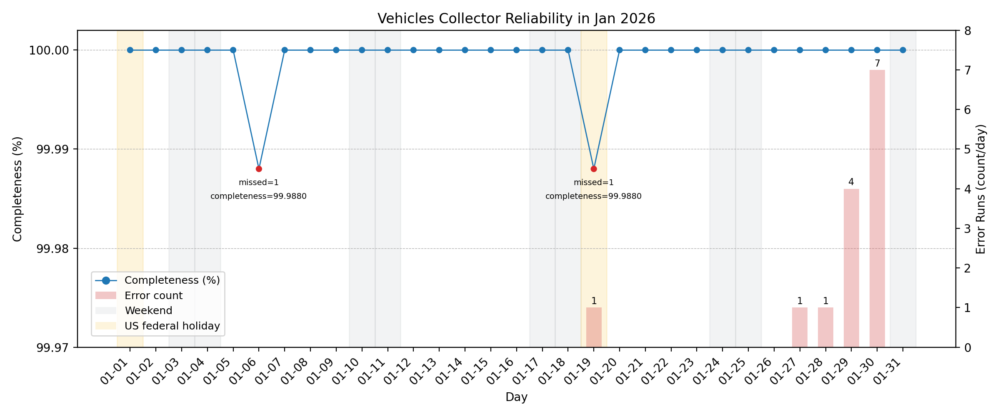

At one request every ten seconds, the vehicle collector should run **8,640 times a day**. Across January's 31 days, that's **267,840 expected runs**.

I recorded **267,838 runs**. Just two scheduled intervals were missing, or roughly **99.999% run completeness**. The gaps were on January 6 and January 19, and neither turned into a longer outage.

The collector also logged **14 `ReadTimeout` errors**. Those count as executions because the script ran and saved an error record, but they don't count as successful vehicle snapshots. I think that's an important distinction: a scheduler can work perfectly while an API request fails.

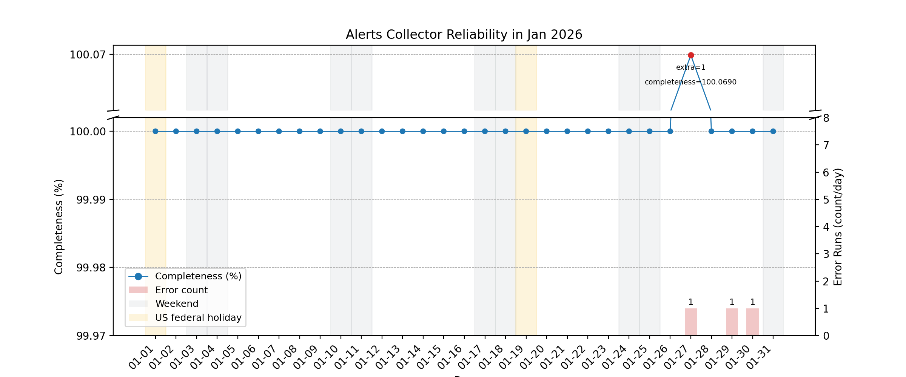

The alert collector should run once per minute, so I expected **44,640 runs** for January. Its execution completeness was effectively 100%, with a few isolated API errors near the end of the month.

One day, January 27, goes slightly above 100% in the raw count. I had manually run the collector outside its normal schedule for an unrelated test, so that extra record isn't evidence of a timer firing twice.

## How accurate was the schedule?

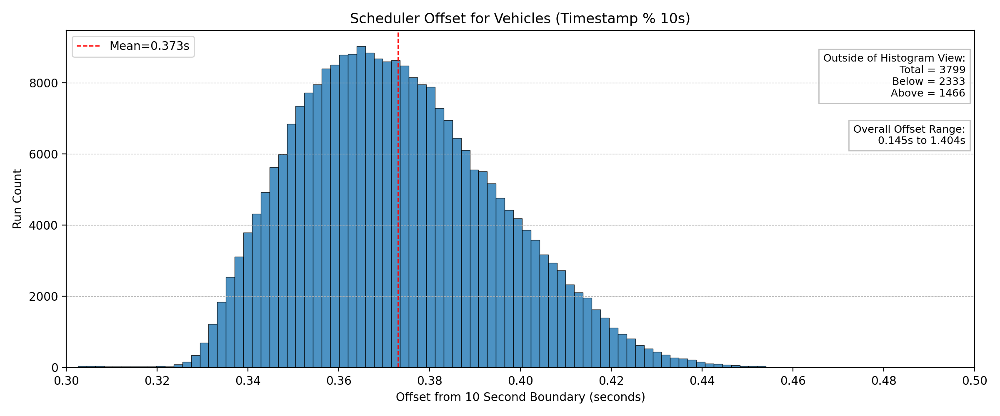

Getting _a_ snapshot every ten seconds is useful, but I also wanted the snapshots to stay close to the same positions on the clock. Otherwise I could end up with requests slowly drifting away from where I intended them to be.

The vehicle collection timestamps averaged about **0.373 seconds after the scheduled ten-second boundary**. Most were in a pretty narrow range of **0.33–0.42 seconds**, with a wider observed range of **0.145–1.404 seconds**.

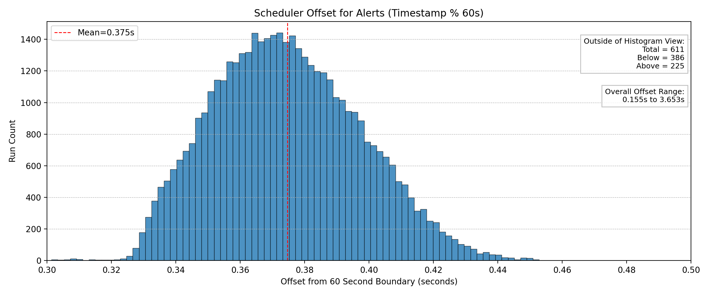

Alerts were similarly consistent, with an average offset around **0.375 seconds** from their scheduled time.

I wasn't expecting perfect millisecond timing on a small Linux droplet. I mainly wanted to make sure delays from one request weren't being added to the next, and these plots suggest that wasn't happening.

## How quickly did the MBTA API respond?

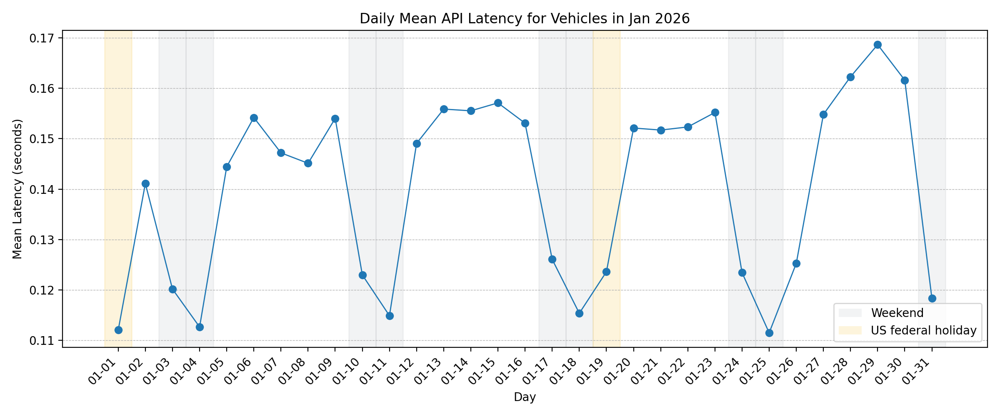

Most daily _mean_ vehicle API response times were around **0.11–0.17 seconds**. There's a small increase around the late-January storm, followed by a return to the earlier range.

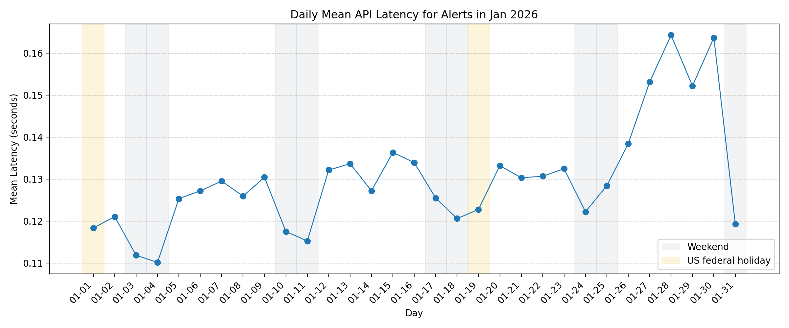

The alerts endpoint was similar, generally around **0.11–0.16 seconds** per request on a daily-average basis.

These are averages, not worst-case response times. The 14 vehicle `ReadTimeout` errors are a reminder that an endpoint can have a very low average and still occasionally take longer than the five-second timeout.

## How much data was I saving?

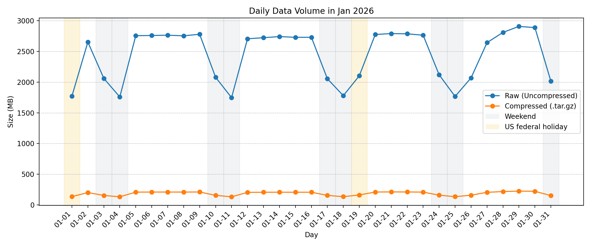

Quite a bit, actually. Weekdays generally produced around **2.7–2.9 GB of uncompressed data per day**. Weekends were lower, usually about **1.75–2.1 GB**.

There's also a drop during the January 25–26 storm period. Fewer vehicles or changes in service might explain some of it, but raw API response size isn't a perfect measure of transit activity. It also depends on what each response contains.

### Compression

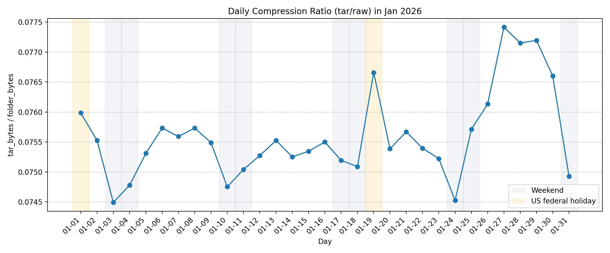

Fortunately, the data compresses really well. On average, the `.tar.gz` archives were about **7.5% of the original size**. That's roughly a **92.5% reduction**, which is a lot nicer to store long-term.

The compression ratio stayed fairly steady even when daily raw volume changed.

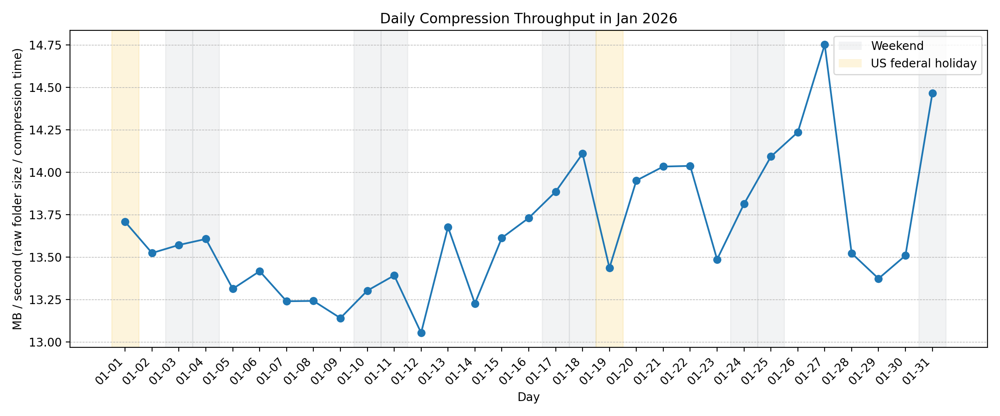

Compression speed was generally around **13–14.7 MB/s** for the month. There wasn't much variation, even on days when the amount of data changed.

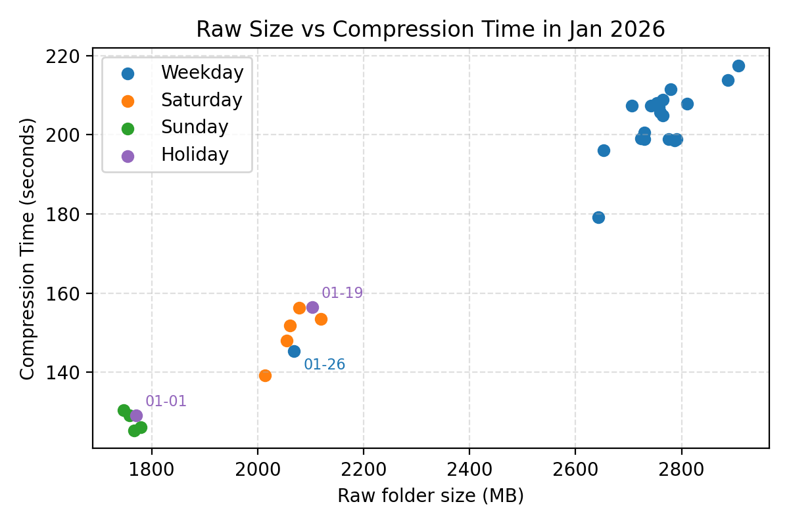

The relationship between raw folder size and compression time was pretty consistent: more data generally meant more time. January 26 stands out because there was considerably less data than on most other days. This was during the big snowstorm, so reduced transit service might explain some of that difference, but I can't say for sure from this graph alone.

## What about the daily uploads?

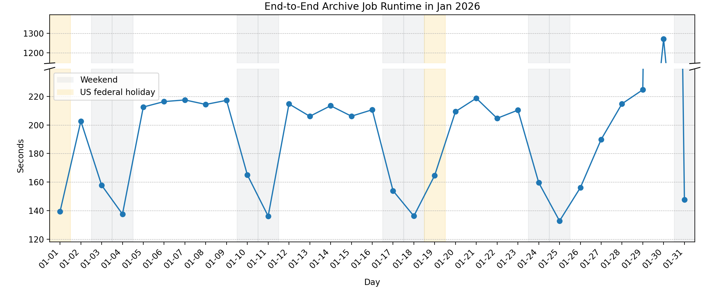

Most archive jobs took around **130–220 seconds** from start to finish. January 30 was the exception. That one took about **1,270 seconds**, or a little over 21 minutes.

I wanted to know why it suddenly took so much longer, so I compared it with the compression and upload graphs.

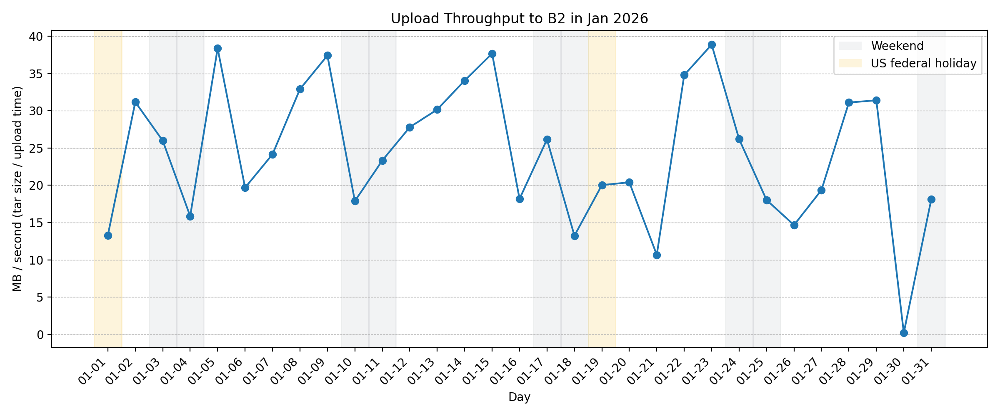

Most days had upload throughput somewhere around **10–40 MB/s**. January 30's throughput, however, was close to zero. Compression speed on the same day looked fairly normal.

**My best guess is that the extra time came from the upload stage**, not from creating the archive. A temporary problem with the network connection, upload service, or some other I/O delay would fit what the graphs show. But I don't have enough information here to say which one it was. I'd need more detailed upload logs to pin it down.

The next day's runtime was back to normal, so at least it didn't turn into a recurring problem that month.

## What did the transit data look like?

This wasn't supposed to be a full study of MBTA operations. I was mostly checking how the collector behaved, but I had all these snapshots sitting there, so of course I wanted to look at a few patterns.

### Vehicle activity by hour

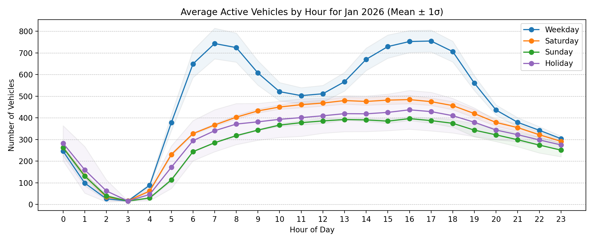

Weekdays show two pretty clear commute peaks, around **7–9 AM** and **3–6 PM**. Weekends are lower and flatter, and holidays look more like weekends than normal weekdays.

There was some unusual variation around the snowstorm. I'd expect the weather and service changes to affect vehicle counts, but I haven't separated their effects from any other schedule changes. So I wouldn't treat this graph alone as proof of what caused the dips.

### Active service alerts

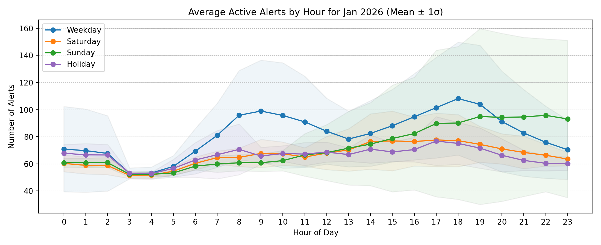

Active alert counts generally climbed through the morning and were highest in the afternoon. The Sunday variation was especially noticeable around the storm.

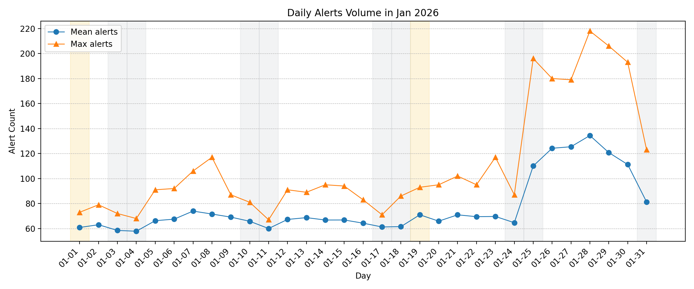

For much of January, daily mean active-alert counts stayed around **60–75**, with daily peaks usually below **120**. Starting around January 25, the peaks went above **200**.

There's a catch to interpreting this one: I'm counting **alerts active in each API response**, not new or unique incidents. A notice about an elevator being out of service can appear in snapshot after snapshot. This graph says how many notices were active at a given time, not how many new incidents occurred that day.

The jump near the storm is still interesting; I just don't want to give it a meaning the data can't support on its own.
